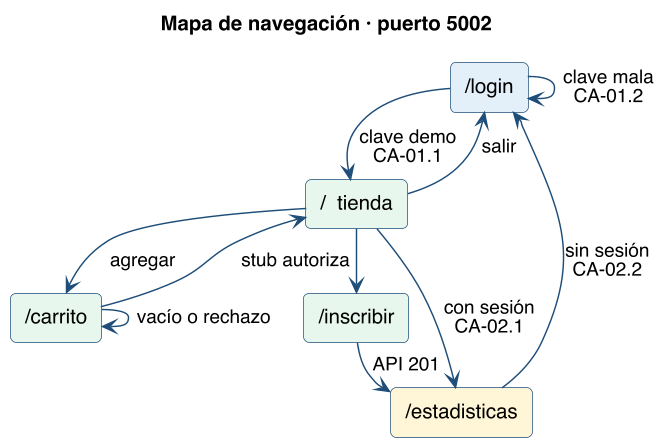
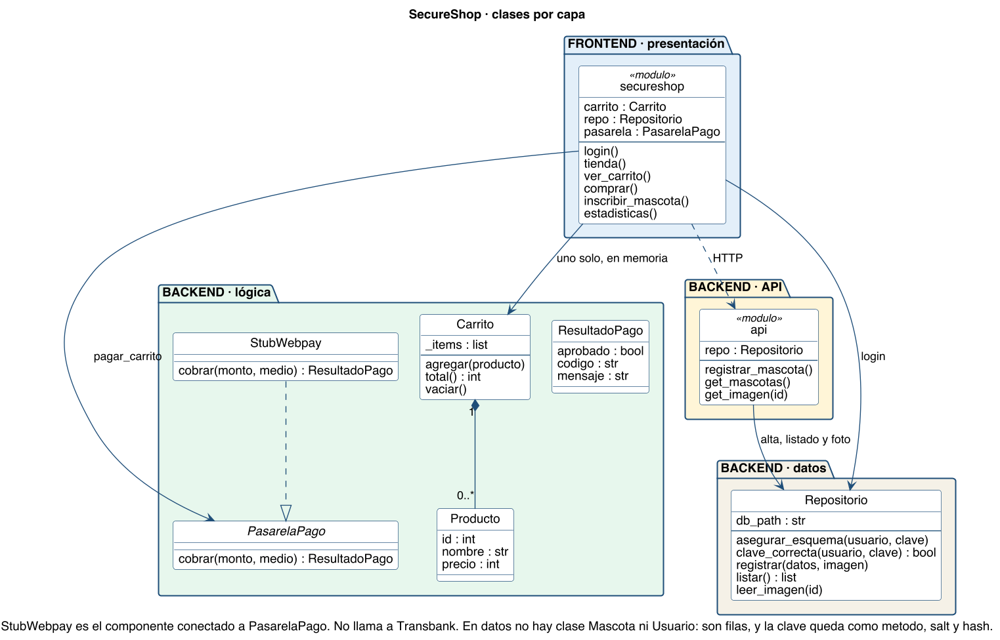

# Diseño detallado

La arquitectura dice las capas. Acá está el diseño de la presentación (qué pantalla sigue a cuál) y el de las clases.

## Mapa de navegación

Todas estas rutas las sirve `secureshop.py` en el puerto 5002. Sin sesión, tienda, carrito, inscribir y estadísticas vuelven a `/login`.

| Desde | Acción | Llega a |
|---|---|---|
| `/login` | Clave demo | `/` tienda (CA-01.1) |
| `/login` | Clave incorrecta | Se queda en `/login` (CA-01.2) |
| `/` | Agregar un producto | `/carrito` |
| `/carrito` | Finalizar compra y el stub autoriza | `/` |
| `/carrito` | Carrito vacío o el stub rechaza | Se queda en `/carrito` |
| `/` | Inscribir y la API responde 201 | `/estadisticas` |
| `/` | Estadísticas, con sesión | `/estadisticas` (CA-02.1) |
| cualquiera de la tienda | Sin sesión, o Salir | `/login` (CA-02.2 en estadísticas) |

La foto de una mascota no es otra pantalla: es la imagen dentro de la tabla de estadísticas (`/mascota/<id>/imagen`).

## Diagrama de clases

`secureshop` y `api` son módulos: agrupan funciones. Las clases están en `nucleo`. No hay clase Mascota ni Usuario: son filas de la base. La clave queda como método, salt y hash.

