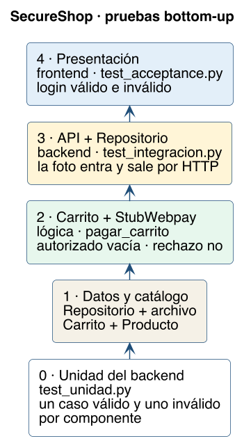

# Pruebas de integración

El archivo es `SecureShop/tests/test_integracion.py`. Acá se juntan componentes que las unitarias ya vieron solos.

```bash
cd SecureShop && source .venv/bin/activate
python -m pytest tests/test_integracion.py -q
```

## Estrategia: de abajo hacia arriba

Bottom-up quiere decir que el primer ensamble es el de las piezas de más abajo. No se abre el navegador para descubrir que el stub rechaza un monto cero: eso ya lo dijo la unidad. La integración pregunta otra cosa: ¿cuando esta pieza llama a aquella, el resultado conjunto es el que corresponde?



| Nivel | Qué se junta | Pregunta nueva | Prueba |
|---|---|---|---|
| 0 | Nada. Cada clase sola | ¿La clase cumple? | [`../unitarias/README.md`](../unitarias/README.md) |
| 1 | `Carrito` + `Producto` del catálogo | ¿El total es la suma de precios reales del catálogo, no de un número escrito en el test? | `test_nivel1_carrito_suma_productos_del_catalogo` (collar 5000 + plato 3000 = 8000) |
| 1 | `Repositorio` + el archivo sqlite | ¿Otra instancia, el mismo archivo, sigue viendo la foto después de “bajar” el objeto? | `test_nivel1_la_foto_sigue_al_abrir_el_mismo_archivo` |
| 2 | `Carrito` + `PasarelaPago` (`StubWebpay`) vía `pagar_carrito` | ¿Autorizar vacía el carrito? ¿Rechazar lo deja? ¿Vacío no autoriza? | `test_nivel2_pago_autorizado_vacia_el_carrito`, `test_nivel2_pago_rechazado_deja_el_carrito`, `test_nivel2_carrito_vacio_no_autoriza` |
| 3 | `api.py` + `Repositorio`, por HTTP de prueba | ¿El POST guarda la foto y el GET la devuelve, y el listado trae el RUT? | `test_nivel3_la_api_guarda_y_devuelve_la_imagen` |
| 4 | Presentación Flask | ¿El login y las estadísticas se ven como dicen los criterios? | `tests/test_acceptance.py`. El plan con el mandante es [`../../01-requerimientos/plan-de-aceptacion.md`](../../01-requerimientos/plan-de-aceptacion.md) |

El nivel 3 usa el cliente de prueba de Flask (`api_client`). No hace falta tener los puertos 5001 y 5002 encendidos. El nivel 2 no usa HTTP: llama a `pagar_carrito` en el mismo proceso. Por eso un fallo del nivel 2 no se confunde con “la API está caída”.

`tests/test_hallazgos.py` no es un nivel de esta escalera. Fija debilidades que se dejan (la API responde sin sesión, `debug=True` sigue en el fuente). Si alguien cierra T01 en silencio, ese archivo tiene que fallar.

## Por qué no se empieza por la pantalla

La pantalla de estadísticas llama a la API, la API llama al repositorio, el repositorio abre el archivo. Si el listado sale vacío, el fallo puede estar en cualquiera de los tres. Bottom-up deja el archivo probado antes de probar la API, y la API probada antes de mirar el HTML. El defecto queda en el primer nivel que se pone rojo.
