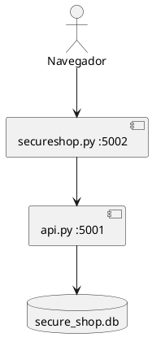

# SecureShop

Tienda de mascotas en Flask. La recibimos hecha. La entrega es con el mandante: el plan de aceptación está escrito y todavía no está corrido con él.

Copia única del repo: esta carpeta. No se mantiene otra dentro de TICS331 ni de TICS413.

> Uso educativo. CC BY-NC-SA 4.0 — `LICENSE`, `NOTICE.md`. Ancla I+D: AwareLab (UAI).

## Cómo levantarlo

Python 3.10+.

```bash
cd "100-websites y repos/repos/repos-ISW-Intedisciplinario/UAI-ISW-SecureShop"
cp -n SecureShop/.env.example SecureShop/.env
./run-local.sh
```

Abrí **http://127.0.0.1:5002/login** con `admin` / `colocolo`. Caés en la tienda. La barra lleva a carrito, inscribir, estadísticas y salir.

Sin sesión, `/`, `/carrito`, `/inscribir` y `/estadisticas` vuelven al login.

Si el puerto está ocupado: `lsof -i :5001 -i :5002` y matar esos procesos. Si el login rechaza la clave demo, borrar `SecureShop/secure_shop.db` y volver a levantar.

Pruebas automáticas (no reemplazan la review con el mandante). Hay casos de unidad sobre catálogo, carrito y repositorio, casos que fijan las debilidades que se dejan, y la aceptación del login:

```bash
cd SecureShop && source .venv/bin/activate
pip install -r requirements-dev.txt && python -m pytest -q
```

El código de la tienda y de la API está repartido en objetos (`SecureShop/nucleo/`: producto, carrito, repositorio). Las rutas siguen en `secureshop.py` y `api.py`. No es la carpeta MVC. Las debilidades de la guía del 4 nov que siguen abiertas están anotadas en [`docs/qa/README.md`](docs/qa/README.md) y no se tapan en este corte.

## Cómo se cambia y cómo se prueba

La línea de base es esta carpeta. Qué entra a git, qué se queda en la máquina, y las seis revisiones de un cambio escrito con IA: [`docs/configuracion-y-pruebas-con-ia.md`](docs/configuracion-y-pruebas-con-ia.md). El CI de GitHub corre `pytest` en cada push y en cada pull request. Rojo bloquea el merge. No reemplaza a la persona en login, sesión, `api.py` ni `.env`.

## QA y pruebas

La clase TICS413 del 4 nov (`11-04/`) apunta acá. El recorrido para seguirlo:

| Parte | Documento |
|---|---|
| Revisión de código, a mano y con Antares | [`docs/qa/README.md`](docs/qa/README.md) |
| Pruebas funcionales con ZAP | [`docs/qa/pruebas-funcionales-zap.md`](docs/qa/pruebas-funcionales-zap.md) |
| Instalar cada herramienta | [`docs/qa/instalacion.md`](docs/qa/instalacion.md) |
| Cómo funcionan y cómo se usan en este testing | [`docs/qa/herramientas.md`](docs/qa/herramientas.md) |

## Arquitectura

Una puerta web y una API. `SecureShopRefactorizadoMVC/` queda en el repo y no la usamos.



El dibujo completo está en [`docs/arquitectura.puml`](docs/arquitectura.puml).

| Pieza | Puerto | Rol |
|---|---|---|
| `SecureShop/secureshop.py` | 5002 | Login, tienda, carrito, inscribir, estadísticas |
| `SecureShop/api.py` | 5001 | Guarda y lista mascotas. No se abre en el navegador |

## Historias que ya vienen implementadas

| ID | Historia | Estado |
|---|---|---|
| US-01 | Como administrador, quiero iniciar sesión, para entrar a la tienda | Implementada |
| US-02 | Como administrador, quiero que `/estadisticas` exija sesión, para no exponer datos | Implementada |

El código también trae catálogo, un carrito en memoria (uno solo para el proceso) e inscribir sin validar RUT ni chip. Eso no son US-03 ni US-04. La lista completa está en [`docs/tickets.md`](docs/tickets.md).

No hay un proyecto de GitHub (canvas) verificado para esos tickets. `gh` no autentica, y el otro acceso es el clone local de la clase de Seguridad TI (`TICS413/.../11-04`), que no confirma un tablero.

## Plan de aceptación

Lo estamos armando en el formato de casos felices e inválidos, para correrlo con el mandante. Todavía no tiene resultados reales: [`docs/plan-de-aceptacion.md`](docs/plan-de-aceptacion.md).

Del material de `TICS331/repo/testing/` se toma la ficha (feliz e inválido, pasos, resultado vacío hasta la review). No se copia el veredicto de ese ejemplo: allí las historias son otras y figuran como ya aceptadas.

## Seguridad (SAST y DAST)

| Qué | Dónde | Estado |
|---|---|---|
| Lectura de código, OWASP Top 10 | [`security/owasp-secureshop-hallazgos.md`](security/owasp-secureshop-hallazgos.md) | Hecha sobre el legado. Hash, sesión y `.env` ya mitigan parte |
| Plan dinámico (ZAP, curl) | [`security/owasp-secureshop-test-plan.md`](security/owasp-secureshop-test-plan.md) | Escrito. No ejecutado |
| Selección Antares | [`security/sast/`](security/sast/LEEME.md) | No verificada: el plan cita el MVC, que no usamos |

Sigue abierto a propósito: `debug=True`, CORS abierto, API sin autenticación.
