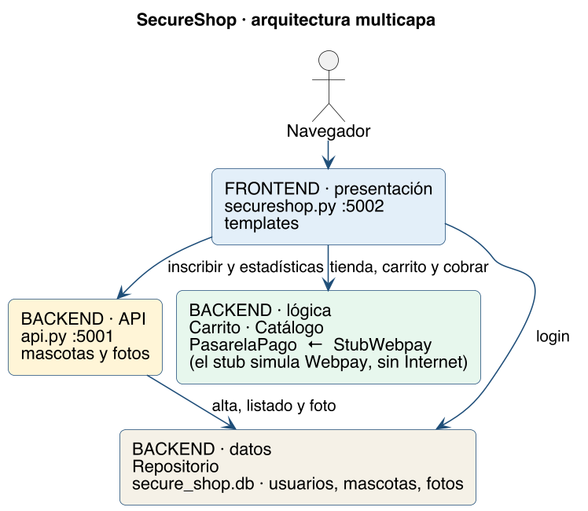
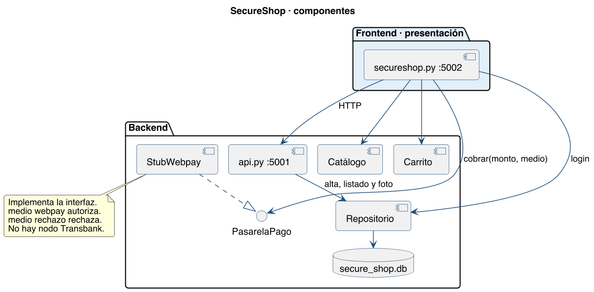
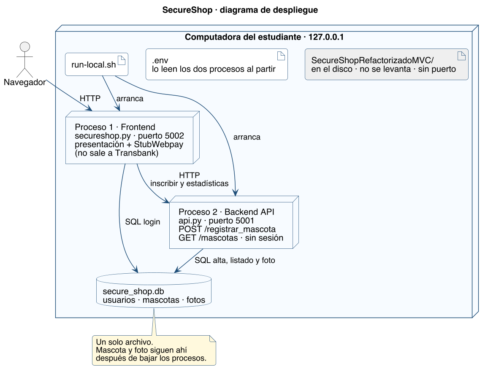

# Arquitectura

Tres estilos conviven. El detalle de clases y el mapa de pantallas están en el diseño: [`../03-diseno/README.md`](../03-diseno/README.md). Cómo se levanta esta topología está en [`../operacion.md`](../operacion.md). `SecureShopRefactorizadoMVC/` está en el repo y no forma parte de esta arquitectura.

## Por capas

El frontend es la presentación. El backend son la API, la lógica y los datos. Cada capa de abajo no conoce la página HTML.

| Capa | Pieza | Puerto |
|---|---|---|
| Frontend · presentación | `secureshop.py` y `templates/` | 5002 |
| Backend · API | `api.py` | 5001 |
| Backend · lógica | `nucleo/carrito.py`, `catalogo.py`, `pago.py` | — |
| Backend · datos | `nucleo/repositorio.py` y `secure_shop.db` | — |

El login de la presentación lee el repositorio directo. Inscribir y estadísticas pasan por la API. Esa flecha que salta de presentación a datos está dibujada: no se esconde.

## Por componentes

Las piezas de la lógica se hablan por una interfaz. `PasarelaPago` es el contrato. `StubWebpay` es el componente conectado. No hay un nodo Transbank.

## Cliente-servidor

Dos procesos en la máquina del estudiante. El navegador es el cliente y solo habla con el puerto 5002. Los dos procesos abren el mismo archivo de base. La mascota, la foto y el hash de la clave viven ahí.

