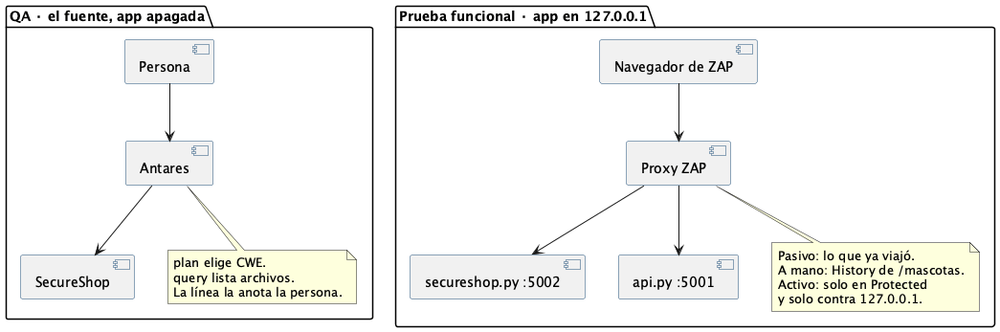

# Operación

Un solo lugar para configuración, despliegue, integración continua, la corrida de la noche, Antares, ZAP, y la norma de ramas, commits y pull requests. Las historias no se copian acá: están en [`01-requerimientos/historias.md`](01-requerimientos/historias.md).

El commit lo hace una persona. El editor no sube solo.

## Gestión de la configuración

| Ítem | En git |
|---|---|
| `SecureShop/secureshop.py`, `api.py`, `nucleo/`, `templates/`, `tests/` | Sí |
| `requirements.txt`, `requirements-dev.txt` | Sí. Sin versión fija: eso sigue abierto (no es un olvido de esta página) |
| `SecureShop/.env.example` | Sí. El `.env` real no |
| `run-local.sh`, `docs/`, `.github/workflows/` | Sí |
| `secure_shop.db`, `.venv/`, informes de Antares o ZAP | No. Informes en `~/pentesting/` |

`SecureShopRefactorizadoMVC/` está en el árbol y no es la línea de base. No se levanta con `./run-local.sh`.

Si `git status` muestra `.env` o un `.db`, no se agregan.

## Norma de rama, commit y pull request

Una rama, una historia o un ticket. El nombre lleva el id:

```text
us-02-ver-estadisticas
ca-02-2-sesion
t01-api-sin-sesion
```

El commit nombra el mismo id y dice qué prueba lo cubre:

```text
US-02: el listado de estadísticas exige sesión

Cubre CA-02.2. pytest tests/test_acceptance.py
```

Reglas:

1. La rama sale de `main`.
2. En la máquina, antes de abrir el pull request: `cd SecureShop && python -m pytest -q`. Rojo: no se abre.
3. El título del pull request empieza por el id (`US-02`, `CA-02.2` o `T01`).
4. El diff incluye el test nuevo, o el test que ya cubría ese id sigue en verde. Un cambio en `nucleo/` sin un caso en `tests/test_unidad.py` o `tests/test_integracion.py` no se mezcla.
5. GitHub corre el mismo pytest en [`.github/workflows/ci.yml`](../.github/workflows/ci.yml). Rojo bloquea el merge.
6. Aprueba una persona. Quien escribió el cambio con un modelo no cuenta como revisor.
7. Login, sesión, `api.py`, `.env` y `nucleo/repositorio.py` piden dos personas, y una de ellas no es un bot.
8. Documentación sola puede entrar sin esa segunda persona. El pytest igual corre si el workflow se dispara.
9. A la tercera vuelta de “arreglé lo que dijo el modelo”, se para. Se mira solo el diff nuevo. Los tickets T01–T06 son “ya estaba”: si el modelo los vuelve a marcar en un PR que no los toca, no se abre otra vuelta para cerrarlos.

La plantilla que GitHub muestra al abrir el PR está en [`.github/pull_request_template.md`](../.github/pull_request_template.md).

No van al chat el `.env`, la base, un RUT que no sea de juguete, ni un informe de ZAP con datos de una corrida.

## Despliegue local

No hay un servidor de producción ni un paquete publicado. El ambiente del alumno es esta máquina. El CI no despliega: prueba.

Python 3.10 o más, desde la raíz del repo:

```bash
cp -n SecureShop/.env.example SecureShop/.env
./run-local.sh
```

Eso crea `.venv` si falta, instala `requirements.txt`, deja la API en **http://127.0.0.1:5001** y la aplicación en **http://127.0.0.1:5002/login** (`admin` / `colocolo`). Ctrl-C baja los dos. El dibujo de esos procesos es [`02-arquitectura/despliegue.png`](02-arquitectura/despliegue.png).

Sin sesión, `/`, `/carrito`, `/inscribir` y `/estadisticas` vuelven al login. Si el puerto está ocupado: `lsof -i :5001 -i :5002`. Si el login rechaza la clave demo, borrar `SecureShop/secure_shop.db` y volver a levantar.

Qué es y qué no es el empaquetado: [`06-construccion/README.md`](06-construccion/README.md).

## Integración continua

En cada push a `main`, `sprint-1`, `sprint-2` o `sprint-3`, y en cada pull request, GitHub (Ubuntu, Python 3.13) instala `SecureShop/requirements-dev.txt` y corre:

```bash
python -m pytest -q
```

Eso incluye unidad, integración, los hallazgos que se conservan y la aceptación automática. No incluye Antares ni ZAP: esos piden el modelo local o una persona en el escritorio.

## Corrida de la noche

[`.github/workflows/noche.yml`](../.github/workflows/noche.yml) corre todos los días a la **01:00**, hora de Chile (UTC−3). En cron de GitHub eso es `0 4 * * *`. También se puede disparar a mano: Actions → Noche → Run workflow.

Hace el mismo pytest, escribe `reporte-noche.xml` (JUnit) y lo deja como artefacto del run. El resumen sale en la página del workflow. Si algo falla, el run queda rojo y el XML igual se guarda.

Esa corrida no levanta la tienda, no llama a Antares y no abre ZAP. El reporte es el de las pruebas que pueden correr solas en GitHub.

## Prueba estática con Antares

Antares lee el fuente. La tienda va apagada. No confirma la falla: `plan` elige CWE, `query` devuelve archivos, la línea la anota quien abre el fuente. Los informes van a `~/pentesting/SAST/`, nunca dentro del repo.



| | Antares | ZAP |
|---|---|---|
| Momento | Repo, app apagada | App encendida, solo `127.0.0.1` |
| Pregunta | ¿En qué archivos miro este CWE? | ¿Qué alerta sale de esta URL? |
| Confirma | Quien anota la línea | Quien llena la ficha |

Instalación en la máquina del alumno (en la sala el modelo ya escucha en el puerto 8000):

```bash
curl -LsSf https://astral.sh/uv/install.sh | sh
export PATH="$HOME/.local/bin:$PATH"
uv tool install cisco-antares-cli
```

`query` y `sweep` hablan con `http://127.0.0.1:8000/v1/completions`, modelo `antares-350m`. El token de Hugging Face no se pega en un chat. En un Mac, `vllm serve` no arranca: hace falta el endpoint de la sala o una GPU NVIDIA. `plan` no necesita el modelo.

Pasos, con la app apagada, desde la raíz del repo:

```bash
mkdir -p "$HOME/pentesting/SAST" "$HOME/pentesting/DAST"
curl -s http://127.0.0.1:8000/health
antares plan SecureShop --scope owasp --max-cwes 10 \
  > "$HOME/pentesting/SAST/plan-owasp.txt"
```

Si el plan nombra `controllers/carrito_controller.py`, apuntó a la carpeta MVC. Se borra la salida y se repite sobre `SecureShop`.

```bash
export ANTARES_ENDPOINT="http://127.0.0.1:8000/v1/completions"
export ANTARES_MODEL="antares-350m"
antares query SecureShop --cwe CWE-287 --format markdown \
  --output "$HOME/pentesting/SAST/query-uno"
antares sweep SecureShop --scope owasp --max-cwes 10 --no-tui \
  --output "$HOME/pentesting/SAST/sweep-owasp"
```

`CWE-287` se cambia por uno que haya salido en el plan. La entrega de la clase (la fila por CWE) se escribe en `~/pentesting/SAST/`, no en el repo. Los planes viejos que citan el MVC están en `security/sast/` y no son un hallazgo confirmado de esta app.

## Prueba dinámica con ZAP

ZAP se sienta entre el navegador y la aplicación. Solo `127.0.0.1`, puertos 5002 y 5001. El modo de la barra es **Protected**. No se escanea otro host.

1. `./run-local.sh` queda abierto. Tienen que verse el 5001 y el 5002.
2. ZAP 2.17.0, desde https://www.zaproxy.org/download/. En el Mac con Apple Silicon, el instalador aarch64. Modo Protected.
3. Quick Start → Manual Explore → `http://127.0.0.1:5002/login` → Launch Browser. Cuando `127.0.0.1` aparezca en Sites, Include in Context. Lo mismo con `http://127.0.0.1:5001`.
4. En ese navegador: entrar con `admin` / `colocolo`, agregar al carrito, inscribir una mascota con RUT y chip ficticios, salir, y abrir `http://127.0.0.1:5001/mascotas`. El JSON trae RUT y chip sin haber vuelto a entrar. Eso es T01, y sigue abierto.
5. Pasivo: pestaña Alerts, una fila, ficha.
6. A mano: History, el `GET /mascotas` del puerto 5001. Si Alerts no tiene fila, la debilidad igual se vio en la respuesta.
7. Escaneo: Automated Scan de `http://127.0.0.1:5002`, luego si queda tiempo el 5001. Report HTML a `~/pentesting/DAST/`.

Ficha, una por caso, en esa carpeta:

```text
Caso __  ·  pasivo / a mano / escaneo
URL (solo 127.0.0.1):
Qué se hace en ZAP:
Dónde se mira:   Alerts / History / Report
¿ZAP nombró una alerta?   sí / no
Si no la nombró, qué se vio en la respuesta:
```

El plan largo de la guía, no ejecutado, sigue en `security/owasp-secureshop-test-plan.md`. La foto del código viejo está en `security/owasp-secureshop-hallazgos.md`. Ninguno de los dos reemplaza esta sección.
