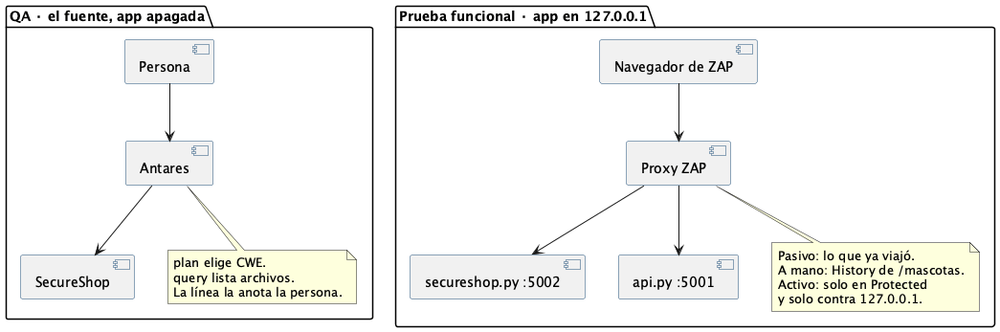

# Antares

Antares mira el fuente con la tienda apagada. No abre el puerto 5001 ni el 5002. El directorio que se le pasa es `SecureShop`.

Hay tres comandos, y no hacen lo mismo:

| Comando | ¿Habla con el modelo? | Qué deja |
|---|---|---|
| `plan` | No. Corre en la máquina, sin GPU | Una lista de CWE y por qué el catálogo los eligió. No dice si el código es vulnerable |
| `query` | Sí. Una investigación, un CWE | `report.md`: archivos candidatos |
| `sweep` | Sí. Una investigación por cada CWE de la misma selección que `plan` | Un `report.md` con esos archivos, agrupados por CWE |

El archivo de texto del `plan` no se le pega al modelo. `sweep` con los mismos argumentos (`--scope owasp --max-cwes 10`) repite esa selección y ahí recién llama al modelo, una vez por CWE.

El modelo devuelve archivos candidatos. No devuelve la línea, no ejecuta la tienda y no prueba que la falla esté activa con la app encendida. Cada archivo se abre y la línea la anota quien lee el fuente. Si la falla responde en los puertos, eso es ZAP: [`zap.md`](zap.md).



| | Antares | ZAP |
|---|---|---|
| Momento | Repo, app apagada | App encendida, solo `127.0.0.1` |
| Pregunta | ¿En qué archivos miro este CWE? | ¿Qué alerta sale de esta URL? |
| Confirma | Quien abre el archivo que nombró el reporte | Quien llena la ficha de [`zap.md`](zap.md) |

Los informes van a `~/pentesting/SAST/`, nunca dentro del repo. El token de Hugging Face no se pega en un chat ni se escribe en el repo.

## 1. Instalar la CLI

Esto sí corre en el Mac. Todavía no es el modelo.

```bash
curl -LsSf https://astral.sh/uv/install.sh | sh
export PATH="$HOME/.local/bin:$PATH"
uv tool install cisco-antares-cli
```

## 2. Tener el modelo escuchando en el puerto 8000

`query` y `sweep` hablan con `POST /v1/completions`. Un chat de otro tipo no sirve: cambia el prompt del modelo.

En la sala el modelo ya está en el puerto 8000 y el nombre servido es `antares-350m`. En ese caso no se levanta `vllm` en el notebook. Se sigue en el paso 3.

Para servirlo en una máquina propia hace falta una GPU NVIDIA y vLLM 0.19.1. `vllm serve` no arranca en un Mac con Apple Silicon. El token se exporta en esa terminal, no se copia a un archivo del repo:

```bash
export HF_TOKEN="el token de esta máquina"
vllm serve fdtn-ai/antares-350m \
  --served-model-name antares-350m \
  --host 127.0.0.1 \
  --port 8000 \
  --trust-remote-code \
  --dtype bfloat16 \
  --max-model-len 16384 \
  --gpu-memory-utilization 0.90 \
  --generation-config vllm
```

Esa terminal queda abierta. El nombre `--served-model-name` tiene que ser exactamente `antares-350m`, el mismo que va en el perfil. `antares-1b` (`fdtn-ai/antares-1b`) es el checkpoint más grande; si se usa ese, el nombre servido y el del perfil pasan a `antares-1b`.

## 3. Decirle a la CLI dónde está el modelo

Una sola vez, en `~/.antares/profiles.toml`:

```toml
[profiles.hosted-antares]
display_name = "Antares de la sala"
model = "antares-350m"
backend = "remote"
endpoint_env = "ANTARES_ENDPOINT"
context_window = 16384
remote_timeout_seconds = 300

[profiles.hosted-antares.generation]
max_tokens = 4096
temperature = 0.3
top_p = 1.0
frequency_penalty = 0.3
stop_tokens = ["<|end_of_text|>", "<|start_of_role|>"]
use_completions_api = true
```

En la terminal de trabajo, con la tienda apagada y desde la raíz del repo:

```bash
export PATH="$HOME/.local/bin:$PATH"
export ANTARES_ENDPOINT="http://127.0.0.1:8000/v1/completions"
export ANTARES_MODEL="antares-350m"
curl -sS http://127.0.0.1:8000/health
antares models list
```

`health` tiene que responder antes de seguir. Si no responde, el modelo no está arriba y `sweep` no tiene a quién preguntarle.

## 4. Elegir los CWE, sin el modelo

```bash
mkdir -p "$HOME/pentesting/SAST"
antares plan SecureShop --scope owasp --max-cwes 10 \
  > "$HOME/pentesting/SAST/plan-owasp.txt"
```

Se abre `plan-owasp.txt` y se anota la lista de CWE. Eso es el programa de la corrida. Todavía no hay un veredicto.

## 5. Pasar esa misma selección al modelo

`sweep` vuelve a calcular el `plan` con los mismos flags y llama al modelo por cada CWE. No hace falta redirigir el `.txt`.

```bash
antares sweep SecureShop --scope owasp --max-cwes 10 \
  --workers 1 --no-tui --profile hosted-antares \
  --output "$HOME/pentesting/SAST/sweep-owasp"
```

`--workers 1` deja una investigación a la vez, para no saturar el puerto 8000. Al terminar, el reporte es:

```text
~/pentesting/SAST/sweep-owasp/report.md
```

Ahí están los archivos que el modelo marca, agrupados por CWE. Se abre cada archivo dentro de `SecureShop/` y se anota la línea en la ficha. El modelo no la numera.

Para un solo CWE de esa lista, se copia el id al comando. Ejemplo si el plan trajo `CWE-287`:

```bash
antares query SecureShop --cwe CWE-287 --profile hosted-antares \
  --output "$HOME/pentesting/SAST/query-uno"
```

El texto queda en `~/pentesting/SAST/query-uno/report.md`. El id se cambia por uno que esté en `plan-owasp.txt`.

La ficha, una por CWE, también en `~/pentesting/SAST/`:

```text
CWE:
Archivo que nombró report.md:
Línea que vi al abrirlo:
¿El modelo alcanzó para decir que está activa en el puerto?   no
Dónde se mira encendida:   zap.md, el código OWASP de esa fila
```

La última fila se completa con la app encendida, en [`zap.md`](zap.md). Antares no la puede llenar. El archivo que se entrega de esta corrida es `~/pentesting/SAST/sweep-owasp/report.md`, junto con las fichas. Cómo se junta con el de ZAP: [`reporte.md`](reporte.md).
